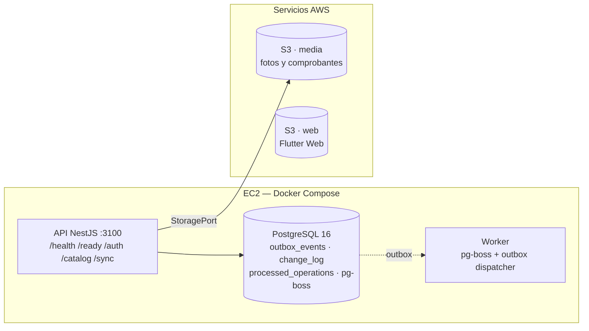

# TRACOP

Monorepo de TRACOP, plataforma móvil de abastecimiento agropecuario. Esta fase contiene la base técnica (API, contratos compartidos, configuración, infraestructura local y documentación) y el módulo de identidad con autenticación por teléfono + OTP, y el módulo de mensajería con bot de Telegram (webhook y polling).

## Requisitos

- Node.js 22 (`.nvmrc`)
- pnpm 9.15.4 (`corepack enable`)
- Docker Compose

## Desarrollo

```bash
cp .env.example .env
# Completa DATABASE_URL, PostgreSQL, JWT_SECRET, OTP_HMAC_SECRET y RATE_LIMIT_HMAC_SECRET.
pnpm install
docker compose up -d
pnpm db:migrate
pnpm dev
```

La API queda disponible en `http://localhost:3000/health`; OpenAPI está en `/docs`. En desarrollo, OTP se imprime en la terminal con el teléfono enmascarado. MinIO es opcional: completa `MINIO_ROOT_USER` y `MINIO_ROOT_PASSWORD` y ejecuta `docker compose --profile storage up -d minio` solo cuando pruebes almacenamiento de objetos. MinIO no tiene CORS por bucket: los orígenes del navegador permitidos se fijan en el servidor con `MINIO_CORS_ALLOWED_ORIGINS` (por defecto `http://localhost:8081`); `pnpm storage:configure-cors` es para proveedores S3 con CORS por bucket.

### Trabajador (tareas periódicas y outbox)

```bash
pnpm --filter @tracop/api worker        # desarrollo (tsx)
pnpm --filter @tracop/api worker:start  # tras pnpm build (node dist/worker.js)
```

Imprime `Worker ready. Registered jobs: …` y se detiene limpio con `Ctrl+C`/`SIGTERM`. Expira lotes, reservas y cotizaciones, emite las liquidaciones de pagos vencida la ventana de reclamo, envía las notificaciones pendientes, purga fotos huérfanas y datos vencidos (OTP, sesiones, ventanas de rate limit, updates de Telegram) y despacha el outbox. pg-boss crea su schema `pgboss` al arrancar. Crons y retenciones: variables `JOB_*`, `OUTBOX_*` y `*_RETENTION_*` ([ADR-016](docs/adr/ADR-016.md)).

## Bot de Telegram (creación y configuración)

### 1. Crear el bot con @BotFather

1. Abre Telegram y busca **@BotFather**.
2. Envía `/newbot` y sigue las indicaciones:
   - **Nombre**: el que verán los usuarios (ej. "TRACOP Demo").
   - **Username**: debe terminar en `bot` (ej. `tracop_demo_bot`). Guárdalo: es `TELEGRAM_BOT_USERNAME`.
3. @BotFather te dará el **token**. En esta guía se representa como `<TELEGRAM_BOT_TOKEN>`; reemplaza el marcador por el valor que te entregue BotFather y no lo compartas.

### 2. Variables de entorno obligatorias

Edita `.env` y completa:

```env
TELEGRAM_MODE=webhook
TELEGRAM_BOT_TOKEN=<TELEGRAM_BOT_TOKEN>
TELEGRAM_WEBHOOK_SECRET=un_secreto_largo_aleatorio_para_validar_webhook
TELEGRAM_BOT_USERNAME=tracop_demo_bot
TELEGRAM_API_ROOT=https://api.telegram.org
TELEGRAM_WEBHOOK_PROCESS_TIMEOUT_MS=5000
TELEGRAM_RATE_LIMIT_PER_SENDER=20
TELEGRAM_RATE_LIMIT_GLOBAL=300
TELEGRAM_RATE_LIMIT_WINDOW_SECONDS=60
```

> `TELEGRAM_WEBHOOK_SECRET` debe ser un string aleatorio largo (mín. 32 caracteres). Se usa en la cabecera `x-telegram-bot-api-secret-token` para validar que el webhook viene de Telegram.

### 3. Probar con polling (desarrollo local sin túnel)

Para probar sin exponer un HTTPS público:

```env
TELEGRAM_MODE=polling
# TELEGRAM_WEBHOOK_SECRET no es necesario en polling
```

Ejecuta `pnpm dev`. El bot arranca en polling (`bot.on('message')`) y borra cualquier webhook previo. Escribe `/start` al bot en Telegram; deberías ver el botón "Compartir contacto".

> **Nota**: `TELEGRAM_MODE=polling` solo funciona con `NODE_ENV=development`. En producción **debe** ser `webhook`.

### 4. Registrar el webhook (producción / túnel local)

Con un HTTPS accesible desde internet (ej. ngrok, Cloudflare Tunnel, dominio propio):

```bash
# Ejemplo con ngrok
ngrok http 3000
# Copia la URL HTTPS (ej. https://abcd1234.ngrok-free.app)
```

Registra el webhook con el script incluido (usa las variables del `.env`):

```bash
pnpm telegram:set-webhook -- https://abcd1234.ngrok-free.app/webhooks/telegram
```

El script envía `allowed_updates: ['message']`, lo que coincide con lo que procesa el código actual (mensajes de chat privado). Si en el futuro se añade soporte para botones inline (`callback_query`), habrá que agregarlo tanto aquí como en el normalizador.

Verifica:

```bash
curl "https://api.telegram.org/bot<TELEGRAM_BOT_TOKEN>/getWebhookInfo"
```

Debe mostrar `url` con tu endpoint, `has_custom_certificate: false`, `pending_update_count: 0` y `last_error_date: 0`.

Vuelve a `.env` y pon `TELEGRAM_MODE=webhook`. Reinicia `pnpm dev`.

### 5. Vincular tu cuenta (flujo completo)

1. Escribe `/start` al bot.
2. Toca el botón **"Compartir contacto"**.
3. El bot responde "¡Cuenta vinculada!" (o "Ya estaba vinculada").
4. Ahora `/auth/otp/request` con tu teléfono enviará el OTP por Telegram (si `OTP_SENDER=telegram`).

## Autenticación (identity)

El módulo `identity` expone `/auth/register`, `/auth/otp/request`, `/auth/otp/verify`, `/auth/refresh`, `/auth/logout`, `GET /me` y `PATCH /me`. El detalle de capas, flujo y concurrencia está en [docs/ARCHITECTURE.md](docs/ARCHITECTURE.md#identity-y-autenticación), la decisión en [ADR-008](docs/adr/ADR-008.md) y la superficie del módulo en [apps/api/src/modules/identity/README.md](apps/api/src/modules/identity/README.md).

Variables JWT relevantes (ver `.env.example`):

| Variable                      | Requisito / valor por defecto   |
| ----------------------------- | ------------------------------- |
| `JWT_SECRET`                  | Obligatoria, mínimo 32 bytes    |
| `JWT_ISSUER`                  | Por defecto `tracop`            |
| `JWT_AUDIENCE`                | Por defecto `tracop-api`        |
| `JWT_CLOCK_TOLERANCE_SECONDS` | Por defecto `5`, máximo `60`    |
| `ACCESS_TOKEN_TTL_SECONDS`    | Por defecto `900` (15 minutos)  |
| `REFRESH_TOKEN_TTL_SECONDS`   | Por defecto `2592000` (30 días) |

Los roles internos (`operator`, `finance`, `admin`) se crean por CLI o seed, nunca por HTTP:

```bash
pnpm identity:create-staff --phone "+57 300 000 0000" --name "Nombre" --role operator
# En producción exige --confirm; el comando se rechaza con NODE_ENV=test.
```

Cada alta queda en `backoffice.audit_log` como acción del sistema (`staff.create`, solo con el rol). Los parámetros de negocio (comisión, flete, vigencias, ventanas) los cambia un `admin` en `PUT /backoffice/parameters/{key}`; sin valor guardado rige la variable de entorno.

El seed local sintético es `pnpm db:seed` y solo se permite con `NODE_ENV=development`.

El mismo seed crea además categorías y productos sintéticos `[DEMO]` del catálogo (actualmente papa, mora y cebolla); es idempotente respecto a esas categorías y productos. No crea lotes. Para expirar lotes publicados cuya disponibilidad terminó, ejecuta `pnpm catalog:expire-lots`; el comando informa cuántos lotes expiró. Debe programarse externamente si se requiere ejecución periódica.

Configuración del catálogo en `.env` (todos los valores tienen defaults):

| Variable                             | Default | Uso                                                                                    |
| ------------------------------------ | ------: | -------------------------------------------------------------------------------------- |
| `CATALOG_LOT_MAX_HORIZON_DAYS`       |    `90` | Horizonte máximo de disponibilidad de un lote (límite de configuración: 365 días).     |
| `CATALOG_SEARCH_RADIUS_MAX_KM`       |   `500` | Radio máximo permitido para búsqueda por ubicación (límite de configuración: 1000 km). |
| `CATALOG_SEARCH_RATE_LIMIT`          |    `60` | Búsquedas por usuario autenticado dentro de una ventana.                               |
| `CATALOG_SEARCH_RATE_WINDOW_SECONDS` |    `60` | Duración de la ventana de rate limit de búsqueda.                                      |

El rate limit de búsqueda se mantiene en memoria por proceso. Ver [arquitectura del catálogo](docs/ARCHITECTURE.md#catálogo) y [ADR-010](docs/adr/ADR-010.md).

## Sincronización del catálogo (sync)

La sincronización implementada cubre cambios de `category`, `product` y `lot`. `POST /sync/push` acepta entre 1 y 50 operaciones; actualmente solo hay manejador de push para `lot`. `GET /sync/pull` acepta páginas de 1 a 500 cambios y usa por defecto `limit=200` y `cursor=0`. Requiere autenticación.

En pull, categorías y productos se registran como taxonomía global visible para usuarios autenticados; los cambios de lotes se entregan únicamente a su dueño. Esto no implementa un catálogo público offline: no hay pull público sin autenticación ni soporte de sincronización para otras entidades.

Para inicializar el registro de cambios con el estado actual del catálogo, ejecuta:

```bash
pnpm catalog:backfill-changes
```

El comando registra cambios base para categorías, productos y lotes que aún no tengan historial, y reporta cuántos registró o saltó. No reemplaza el pull/push ni agrega manejadores de sincronización para otras entidades.

## Mensajería (messaging)

El módulo `messaging` recibe updates de Telegram (webhook o polling), normaliza a `InboundMessage`, aplica rate limiting e idempotencia, y delega a la aplicación.

**Tipos soportados**: texto, contacto (botón de compartir). Los tipos voz, foto y ubicación se normalizan correctamente a `InboundMessage` pero el bot responde «aún no disponible» hasta que se implemente el asistente de IA. La decisión está en [ADR-009](docs/adr/ADR-009.md) y la arquitectura en [docs/ARCHITECTURE.md](docs/ARCHITECTURE.md#messaging-telegram--whatsapp).

## Pruebas

```bash
pnpm test                       # todas las unidades y aplicaciones del monorepo
pnpm --filter @tracop/api test  # solo la API, con cobertura
```

Las pruebas de la API requieren Docker: Jest con `--coverage` levanta PostgreSQL 16 con Testcontainers. Las pruebas de identity son `apps/api/test/identity.e2e-spec.ts` (flujo, concurrencia y reuse detection), `identity-logging.e2e-spec.ts` (redacción de logs), `identity-application.spec.ts`, `identity-authorization.spec.ts` y `otp-sender.contract-spec.ts`. La cobertura se mide sobre dominio, aplicación, `app.module`, `worker-jobs`, `worker-lifecycle`, `shared/auth` y `shared/kernel`; umbrales: dominio 90 % de líneas, aplicación 80 %, global 75 %.

## Lot photos

Lot photos use an S3-compatible object store. For local development, set `MINIO_ROOT_USER` and `MINIO_ROOT_PASSWORD` in `.env`, then start the optional MinIO profile:

```bash
docker compose --profile storage up -d minio
```

MinIO serves the S3 API at `http://127.0.0.1:9000` and its console at `http://127.0.0.1:9001`. Create the bucket named by `S3_BUCKET` before using photo endpoints. Set `S3_ENDPOINT` to the API endpoint and `S3_PUBLIC_ENDPOINT` to an endpoint reachable by clients (defaults to `S3_ENDPOINT`). Configure `S3_REGION`, `S3_BUCKET`, and credentials. `S3_API_ACCESS_KEY`/`S3_API_SECRET_KEY` are used for API object operations; `S3_POLICY_ACCESS_KEY`/`S3_POLICY_SECRET_KEY` sign upload POST policies. If policy credentials are omitted, the adapter falls back to API credentials. Production requires both endpoint(s) over HTTPS, bucket, region, and both credential pairs.

The `.env.example` comments describe suggested least-privilege S3 permissions: API credentials need `GetObject`, `PutObject`, and `DeleteObject` for bucket objects and `ListBucket` restricted to `incoming/` and `photos/`; policy credentials need `PutObject` on `incoming/*`. These permissions have not been verified against a real S3 provider. Do not use root credentials in production.

Photo limit defaults (all configurable) are:

| Variable                                   |    Default | Purpose                                          |
| ------------------------------------------ | ---------: | ------------------------------------------------ |
| `CATALOG_PHOTO_MAX_COUNT`                  |        `5` | Maximum photos per lot (configuration cap: 5).   |
| `CATALOG_PHOTO_MAX_BYTES`                  |  `5242880` | Maximum input/output size in bytes (cap: 5 MiB). |
| `CATALOG_PHOTO_MAX_INPUT_PIXELS`           | `25000000` | Maximum input pixel count.                       |
| `CATALOG_PHOTO_MAX_INPUT_DIMENSION`        |    `10000` | Maximum input width or height.                   |
| `CATALOG_PHOTO_MAX_OUTPUT_DIMENSION`       |     `2048` | Maximum output width or height.                  |
| `CATALOG_PHOTO_PENDING_TTL_SECONDS`        |     `1800` | Pending reservation lifetime.                    |
| `CATALOG_PHOTO_UPLOAD_URL_TTL_SECONDS`     |      `900` | Upload policy lifetime.                          |
| `CATALOG_PHOTO_DOWNLOAD_URL_TTL_SECONDS`   |      `300` | Download URL lifetime.                           |
| `CATALOG_PHOTO_PURGE_GRACE_SECONDS`        |     `3600` | Minimum age before orphan deletion.              |
| `CATALOG_PHOTO_WEBP_QUALITY`               |       `80` | WebP quality.                                    |
| `CATALOG_PHOTO_CONCURRENCY`                |        `2` | In-process image conversions.                    |
| `CATALOG_PHOTO_PROCESSING_LEASE_SECONDS`   |      `300` | Processing claim lease.                          |
| `CATALOG_PHOTO_UPLOAD_RATE_LIMIT`          |       `30` | Upload preparations per user per window.         |
| `CATALOG_PHOTO_UPLOAD_RATE_WINDOW_SECONDS` |       `60` | Rate-limit window.                               |

Run `pnpm catalog:purge-orphan-photos` to expire pending photo reservations and remove old unreferenced objects from `incoming/` and `photos/`. Schedule this command externally if periodic cleanup is needed; it does not purge all incoming objects or configure automatic bucket lifecycle cleanup.

See [ADR-011](docs/adr/ADR-011.md) and [catalog photo architecture](docs/ARCHITECTURE.md#lot-photos).

## SonarCloud (pasos manuales)

El análisis de SonarCloud es opcional y vive en `.github/workflows/sonar.yml`. El workflow no falla si el secreto no existe: emite un aviso y omite el análisis. Para activarlo:

1. Crea una cuenta/organización en SonarCloud y el proyecto con la key configurada en `sonar-project.properties`.
2. En GitHub, ve a **Settings → Secrets and variables → Actions → New repository secret** y crea `SONAR_TOKEN` con el token del proyecto de SonarCloud.
3. En SonarCloud, abre el proyecto y desactiva **Automatic Analysis** (**Administration → Analysis Method**) para que el análisis lo ejecute solo el CI y no haya conflicto.
4. Verifica que `sonar.organization` y `sonar.projectKey` en `sonar-project.properties` correspondan a las keys reales.

El workflow ejecuta `pnpm test` antes del escaneo para generar los reportes LCOV que consume Sonar. `sonar-project.properties` excluye adaptadores, puertos, wiring de módulos y `shared/infra` de la cobertura, y excluye `*.spec.ts`/`*.test.ts` de `sonar.sources`. Sin `SONAR_TOKEN`, el paso de análisis se omite con un `::warning::` y el job queda en verde.

## Documentación

- [Arquitectura](docs/ARCHITECTURE.md)
- [Glosario](docs/GLOSSARY.md)
- [ADR-008: autenticación por teléfono + OTP](docs/adr/ADR-008.md)
- [ADR-009: mensajería con Telegram](docs/adr/ADR-009.md)
- [Referencia de la API](docs/API.md) y [contrato OpenAPI](docs/openapi.json)
- [Integración con la app móvil](docs/MOBILE-INTEGRATION.md)
- [ADR-013: logística sin coordenadas, check-ins offline y ubicación exacta para el asignado](docs/adr/ADR-013.md)
- [ADR-014: pedidos, cotizaciones y reservas](docs/adr/ADR-014.md)
- [ADR-015: propuestas de producto](docs/adr/ADR-015.md)
- [ADR-016: trabajador y outbox](docs/adr/ADR-016.md)
- [ADR-017: pagos, ledger y liquidaciones](docs/adr/ADR-017.md)
- [ADR-018: notificaciones](docs/adr/ADR-018.md)
- [ADR-019: audit log, parámetros y métricas](docs/adr/ADR-019.md)
- [ADR-020: calificaciones, reputación y verificación](docs/adr/ADR-020.md)
- [ADR-021: asistente de IA para borradores de lote por Telegram](docs/adr/ADR-021.md)
- [ADR-022: recomendaciones, sugerencia de precios y alertas](docs/adr/ADR-022.md)
- [Despliegue, demo y copias de seguridad](docs/DEPLOYMENT.md) · [Revisión de seguridad](docs/SECURITY-REVIEW.md) · [Prueba de carga](docs/LOAD-TEST.md) · [Retención de sync](docs/SYNC-RETENTION.md)
- [Aviso de privacidad (texto pendiente)](docs/PRIVACY_NOTICE.md)

## Despliegue

La guía operativa completa (perfiles, imagen, copias de seguridad y checklist) está en [docs/DEPLOYMENT.md](docs/DEPLOYMENT.md). Esta sección resume el despliegue de la **demo para jurados** sobre AWS (cuenta real, free tier).

### Arquitectura objetivo

Una sola instancia **EC2** (t3.small, free tier) con Docker Compose corre API + worker + PostgreSQL en contenedores; la imagen se compila en la propia instancia (**sin ECR**). El almacenamiento de objetos usa **AWS S3, no MinIO**: fotos y comprobantes en un bucket privado con URLs prefirmadas, y la versión web de la app en un bucket público. La infraestructura (EC2, buckets, security group, rol IAM de S3) se define con **Terraform** (`terraform/`).



**Piezas clave**

- **Cliente grueso** (app móvil): escribe en SQLite local y encola operaciones con `opId`; al reconectar hace `POST /sync/push` y `GET /sync/pull` (ver [MOBILE-INTEGRATION](docs/MOBILE-INTEGRATION.md)).
- **Cola del lado del servidor**: el outbox (`outbox_events`) y pg-boss alimentan al worker, que expira lotes/reservas, despacha notificaciones y liquida pagos.
- **Descarga**: `GET /sync/pull?cursor=seq` entrega los cambios de `change_log` desde el cursor; el cliente los aplica a SQLite.
- **Storage en S3**: la API ya trae `S3StorageAdapter`; se configura con `S3_ENDPOINT`, `S3_BUCKET`, `S3_REGION` y las credenciales `S3_API_*` / `S3_POLICY_*`. El contenedor MinIO del demo local es solo para desarrollo; en AWS no se arranca.
  > El estilo de direccionamiento se controla con `S3_FORCE_PATH_STYLE` (por defecto `true`, para MinIO). En AWS S3 se usa `false` (estilo virtual-hosted), ya configurado en `docker-compose.aws.yml`.

### Pasos (demo para jurados)

Todo se levanta con Terraform desde [`terraform/`](terraform/README.md): EC2 (imagen compilada en la instancia, sin ECR), buckets S3 (media y web), security group, rol IAM de S3 y clave SSH. No hay que crear recursos a mano.

```bash
# 1) Credenciales de AWS en la máquina (cuenta real)
aws configure

# 2) Aplicar
cd terraform
terraform init
terraform plan
terraform apply
```

```bash
# 3) Guardar la clave SSH y obtener la URL de la API
terraform output -raw ssh_private_key_pem > tracop.pem
chmod 600 tracop.pem
terraform output -raw api_url
```

```bash
# 4) OTP de los usuarios sintéticos (+573000000001..07, uno por rol)
ssh -i tracop.pem ubuntu@$(terraform output -raw ssh_public_ip) \
  'cd /opt/tracop && docker compose -f docker-compose.aws.yml --env-file .env.demo logs api'
```

```bash
# 5) Verificar salud y disponibilidad
curl -fsS "$(terraform output -raw api_url)/health"
curl -fsS "$(terraform output -raw api_url)/ready"
```

El perfil `demo` usa solo datos sintéticos y el OTP se imprime en los logs del API para entrar sin Telegram real. El path de S3 contra AWS real no está verificado (ver [docs/DEPLOYMENT.md](docs/DEPLOYMENT.md)); quedó habilitado con `S3_FORCE_PATH_STYLE=false` y credenciales por instance role.

> **Sin dominio** se usa HTTP; la web y la API deben compartir esquema para evitar *mixed content*. El bootstrap del primer arranque tarda 5–10 min (instala Docker, clona y compila todo).

### Pipeline (CI/CD)

- `.github/workflows/ci.yml` corre lint, typecheck, test y build en cada push/PR.
- `.github/workflows/deploy.yml` actualiza la EC2 por SSH (`git pull` + build + `up -d`), disparo manual.

### Ajustes posteriores

1. **CORS de la web**: para que la Flutter Web funcione desde el navegador, fijá `CORS_ALLOWED_ORIGINS` en la API con el origen que devuelve `terraform output -raw web_endpoint`. El APK no necesita CORS.
